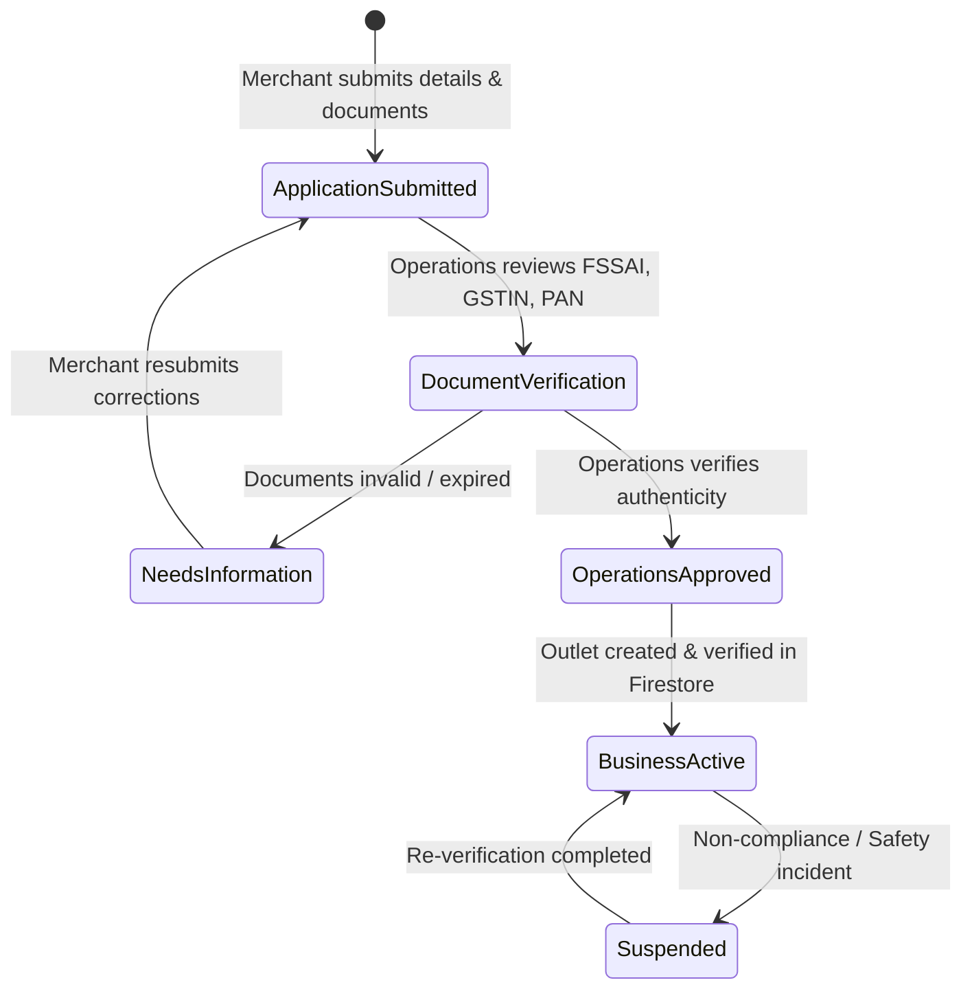

# AllGo Merchant Platform: Operations Runbook

**Date:** 2026-11-04  
**Audience:** Platform Operations, Merchant Support, and Onboarding Administrators  

---

## 1. Merchant Onboarding & Verification Procedure

Every merchant onboarding follows a strict maker-checker approval lifecycle:

### Step-by-Step Operator Verification Checklist:
1. **Identity & PAN:** Verify owner's identity against national database.
2. **Business Registration / Trade License:** Verify shop and establishment certificate or GSTIN on the official GST portal.
3. **FSSAI Verification (Food Businesses):**
   - Lookup the 14-digit FSSAI license/registration number on FoSCoS portal (`foscos.fssai.gov.in`).
   - Confirm active status, matched trade name, and premises address.
   - Verify category (Home Kitchen: registration; Restaurant/Bakery: license).
4. **Bank Account Verification (Penny Drop):** Verify account holder name matches business/owner legal name via penny-drop validation before approval.
5. **Approval Action:**
   - Execute `reviewPartnerApplication` with action `approved`.
   - The Cloud Function provisions `merchant_businesses/{id}` and links the owner's UID in `merchantBusinessAssignments`.
   - The merchant can now sign in and access the merchant portal.

---

## 2. Order Exception & Escalation Workflows

### 2.1 Merchant Order Rejection
- If a merchant cannot fulfill an incoming order (out of stock, kitchen overloaded, closed early):
  - Merchant selects a valid reason from `MerchantRejection` (`out_of_stock`, `kitchen_full`, `store_closing`, `pricing_error`).
  - System executes `rejectMerchantBooking`.
  - Customer order is marked `cancelled_merchant_rejected`.
  - Authoritative payment refund is automatically scheduled via payment webhook/queue.

### 2.2 Grocery Short Picking & Substitution
- If a grocery item is unavailable during packing:
  - Merchant uses `GroceryPickingEditor` to mark the exact packed quantity.
  - Proposes a replacement product with identical or lower price.
  - Customer receives realtime notification to accept or decline the replacement.
  - Authoritative total is adjusted before driver pickup.

### 2.3 Driver Handover Verification
- Driver must arrive at the merchant outlet (`ord.arrivedAtPickup == true`).
- Merchant verifies driver identity and packs the order.
- Merchant taps **"Confirm order handed to rider"** (`confirmMerchantPickup`).
- Order status transitions to `out_for_delivery`.
