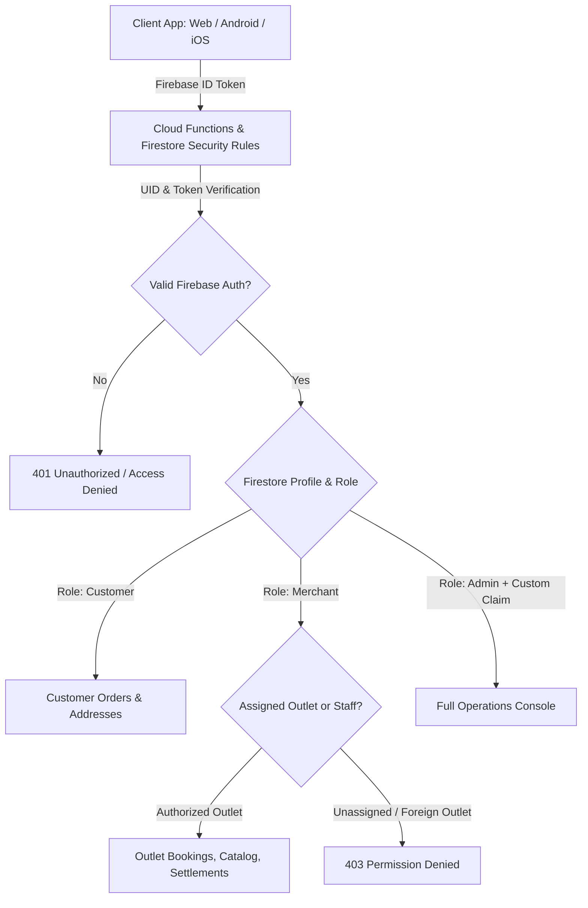

# AllGo Production Security & Access Control Acceptance

**Date:** 2026-11-04  
**Classification:** Security Architecture & Access Control Specification  

---

## 1. Multi-Tenant Isolation & Least Privilege Architecture

The AllGo platform implements defense-in-depth isolation across customers, merchants, drivers, and operations administrators:



---

## 2. Security Boundaries & Enforcements

### 2.1 Firestore Security Rules (`firestore.rules`)
- **No Direct Tenant Write:** Clients cannot write or forge their own `role`, `approvalStatus`, `merchantId`, `merchantBusinessIds`, or `merchantStaffAccess` in `users/{uid}`.
- **Tenant Scoping:**
  ```firestore-security-rules
  // Orders can only be read by the customer who placed them, or the merchant assigned to fulfill them
  match /bookings/{bookingId} {
    allow read: if isCustomer(resource.data.customerId) ||
                   isAssignedMerchant(resource.data.merchantId, resource.data.serviceType);
    allow write: if false; // All mutations must go through authoritative Cloud Functions
  }
  ```
- **Staff Access Limits:** Staff members assigned to a specific outlet cannot see financial balances or modify business settings unless explicit permissions (`orders`, `catalog`, `business`) are granted.
- **Cross-Merchant Protection:** A merchant cannot read or modify another merchant's catalog drafts, stock movements, ledger entries, or customer reviews.

### 2.2 Storage Security Rules (`storage.rules`)
- Private documents (KYC documents, FSSAI certificates, bank passbooks) are stored under private paths:
  `/partner_applications/{appId}/evidence/{docId}`
- Read access is restricted strictly to the applicant UID and operations staff with verified claims.
- Public assets (catalog product images, store banners) are stored under public paths and cached via CDN.

### 2.3 Secret Management & Production Hygiene
- **Zero Secrets in Code:** No Firebase Admin keys, private certificates, database connection strings, or webhook secrets are committed to version control.
- **Environment Isolation:** Secrets are provided at runtime via environment variables or secret managers (Google Cloud Secret Manager / Docker secrets).
- **VITE Prefix Guard:** Backend credentials never use `VITE_` prefix to prevent bundling into client JavaScript.
